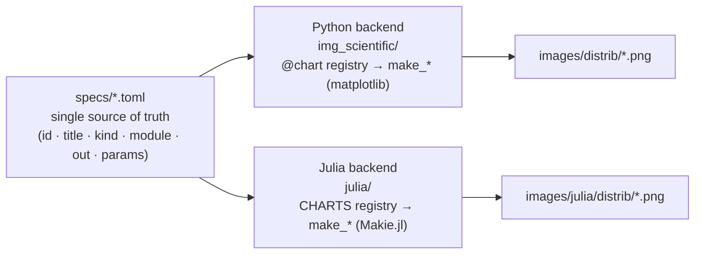
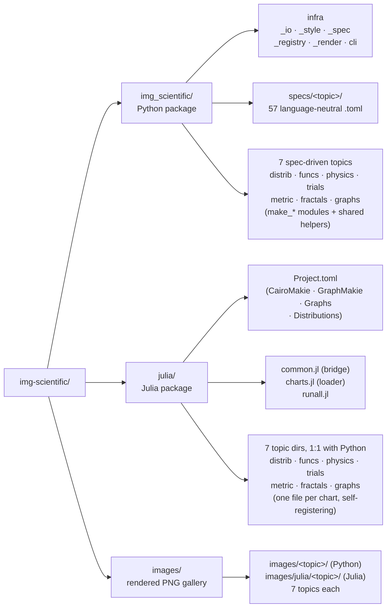

# Images of Data Science


A reproducible **teaching plotting toolkit** for statistics and graph-theory
charts. Every chart can be redrawn **under different parameters** from a single
specification, and the same specification drives **two independent backends** —
Python (matplotlib) and Julia (the Makie.jl ecosystem: CairoMakie for statistical
charts, GraphMakie for graph layouts).

## Architecture

The project follows a **spec contract** design: one repository, two packages,
coordinated by a language-neutral `specs/*.toml` layer. A spec only carries the
contract — `id · title · kind · module · out · params` — and **never** any
plotting logic. Each language therefore keeps its own `id → function` mapping,
so the two backends stay in sync on *what* to draw while remaining free in *how*
they draw it.



The invariant for every `make_*` (in either language) is the same: parameters
are keyword-only, the defaults equal the chart's original magic numbers, and the
function **returns a figure** (no `plt.show`), so the CLI/`runall` script decides
when and where to save.

## Project Structure



- `img_scientific/` — the installable Python package. `_spec.py` reads the TOML
  specs, `_registry.py` provides the `@chart` decorator that maps each `id` to a
  `make_*`, and `_render.py` turns a spec into a saved PNG (lazily importing only
  the module it needs). Discovery is **spec-driven**, not by scanning imports.
- `julia/` — the Julia counterpart, plotting on the **Makie.jl ecosystem**
  (CairoMakie for the statistical charts; GraphMakie's `graphplot` drives the
  `graphs/` topic). `common.jl` re-reads the *same*
  `img_scientific/specs/*.toml`; the chart bodies are split **one file per chart**
  under `distrib/` (mirroring `img_scientific/distrib/distrib_*.py`), each
  self-registering with `register!("distrib/<id>", ...)` — the Julia analogue of
  Python's `@chart` decorator; `charts.jl` is now just a thin loader that pulls
  in the shared `_helpers.jl` and every chart file; and `runall.jl` renders
  everything that has a Julia implementation and politely skips the rest.
- `images/` — output gallery. Python writes to `images/<topic>/`; Julia writes to
  `images/julia/<topic>/` so the two never overwrite each other.
- `python/` — leftover standalone scripts from the pre-packaging layout (kept for
  reference).

## Quick Start

Python (installs the `imgsci` command):

```bash
pip install -e .
imgsci list                     # every chart that has a spec (no plotting deps needed)
imgsci render distrib/geom_pmf  # draw one chart
imgsci render distrib/norm_pdf --set x_num=400   # override a parameter
imgsci gallery --topic distrib  # re-render a whole topic into images/
```

Julia:

```julia
cd julia
julia --project=. -e 'using Pkg; Pkg.instantiate()'
julia --project=. runall.jl     # render every chart with a Julia impl
```

## Chart Catalog

### Probability Distributions

Discrete: Bernoulli, Binomial, Geometric, Hypergeometric, Negative Binomial,
Negative Hypergeometric, Poisson, Multinomial, Categorical.

Continuous: Normal, Log-Normal, Multi-Variate Normal, 3-D Normal, Exponential,
Beta, Gamma, Laplace, Cauchy, Chi-Square, Student-t, F, Uniform, Weibull,
Dirichlet.

### Functions

Sigmoid.

### Covariance & Information Metrics

Covariance ellipse, prior × likelihood covariance product, 3-D covariance
(ellipsoid surface, scatter, marginal surface), entropy, standard error of the
mean (SEM).

### Data-Science Trials

Central Limit Theorem, Law of Large Numbers, convolution of uniforms, product of
two Gaussians, normal distribution with 3 sigmas, normal PDF and CDF.

### Fractals & Complexity

Barnsley fern, multifractal (generalized) dimensions, Koch curve, Koch
snowflake, Sierpinski squares, Sierpinski triangle, Ising model (Wolff cluster).

### Graphs & Networks

Erdős–Rényi G(n, p) and G(n, m), complete directed graph, Watts-Strogatz
rewiring, the small-world C(p)/L(p) experiment, and regular graphs.

## Credits

Charts by Xavier Yang ([@ivaquero](https://github.com/ivaquero)).
